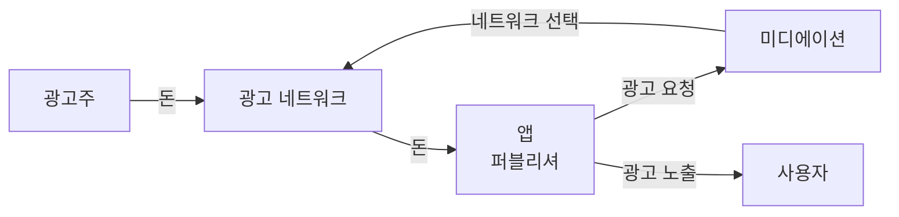
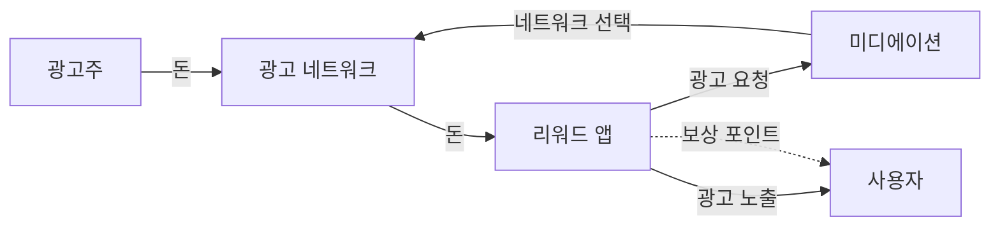

## 개요
최근 광고를 보여주고 돈을 버는 서비스를 다루게 되면서 광고 도메인을 처음부터 공부하고 있다.

광고는 사용자가 돈을 내지 않는데도 서비스가 돈을 번다. 그렇다면 그 돈은 누가, 어떤 경로로 내는 걸까?

도메인을 공부하기 시작하자마자 eCPM, 일치율, 노출률 같은 용어를 접하게 되었다. 그런데 용어를 하나씩 외우는 것보다 **돈이 누구에게서 누구에게 흐르는지**를 먼저 아는 게 나머지를 이해하는 데 더 도움이 됐다.

이번 글에서는 광고 생태계에 누가 참여하고, 각자 왜 필요한지 정리해보려 한다.

## 광고 보는 앱은 어떻게 돈을 버나
광고 보는 앱은 사용자에게 광고를 보여주고 돈을 번다. 매출은 단순하게 보면 두 숫자의 곱이다.

```
광고 매출 = 광고가 보인 횟수 × 한 번당 단가
```

여기서 앱은 광고를 사는 쪽이 아니라 광고 자리를 파는 쪽이다. 이쪽을 **퍼블리셔**(Publisher)라고 부른다.

이 관점이 생각보다 중요했다. 검색해서 나오는 광고 글은 대부분 광고를 사는 쪽(광고주)을 위해 쓰였다. 단가가 오르면 광고주는 비용이 늘고 퍼블리셔는 수익이 는다. 같은 지표라도 어느 쪽에서 보느냐에 따라 의미가 반대다.

## 건물 벽 광고판으로 보는 광고
처음에는 구조를 단순하게 건물 벽 광고판으로 생각해봤다.

| 광고판                    | 앱 광고     |
| ---------------------- | -------- |
| 벽에 광고판 자리가 있는 건물주      | 앱 (퍼블리셔) |
| "우리 신발 광고 걸고 싶어요"라는 회사 | 광고주      |
| 지나가다 광고판을 보는 행인        | 사용자      |

광고주가 건물주에게 돈을 내고, 건물주는 벽을 빌려주고, 행인은 광고를 본다.

그런데 실제 앱 광고에는 광고주와 앱 사이에 중간 업체가 두 겹 더 들어간다.



광고를 고르는 길과 돈이 오가는 길은 다르다. 광고는 미디에이션을 거쳐 골라지지만, 돈은 네트워크가 앱에 직접 준다.

왜 중간이 두 겹이나 필요한지 하나씩 보자.

## 광고 네트워크: 양쪽을 모아주는 시장
신발 회사가 앱에 직접 찾아와서 "광고 자리 사고 싶어요"라고 하면 될 텐데, 왜 중간에 광고 네트워크(Google AdMob, Meta 등)를 거칠까?

### 광고주 입장: 어디에 광고해야 효과적인지 모른다
신발 광고는 실제로 신발을 살 것 같은 사람에게 보여줘야 효과가 있다. 하지만 세상에는 앱이 수만 개 있고, 광고주는 어떤 앱에 그런 사용자가 많은지 알 수 없다.

광고 네트워크는 수많은 앱에 광고를 넣고 있어서 앱이 아니라 **사람**을 기준으로 안다. "이 사람은 다른 앱에서 운동화 광고를 눌렀다" 같은 것들이다.

그래서 광고주는 "이 앱에 광고해 주세요"가 아니라 "운동화를 살 것 같은 사람이 어느 앱을 켜든 그 사람에게 보여주세요"라고 요청할 수 있다.

### 앱 입장: 광고주와 하나하나 계약할 수 없다
반대쪽도 마찬가지다. 광고를 사고 싶은 회사가 수천 곳인데, 앱이 그들을 하나하나 만나 계약하고 돈을 받을 수는 없다.

```
네트워크가 없으면:  광고주 수천 곳 × 앱 수만 개 = 셀 수 없이 많은 계약
네트워크가 있으면:  광고주 → 네트워크 ← 앱     (각자 네트워크 한 곳과만 계약)
```

광고 네트워크는 양쪽을 한곳에 모아주는 시장이다.

### 처음에 잘못 생각했던 것
처음에는 광고 네트워크를 "광고를 대신 집행해주는 대행사" 정도로 생각했다. 그런데 사람이 전략을 짜주는 대행사보다는 **자동으로 돌아가는 경매 시장**에 가까웠다.

사용자가 광고 자리가 있는 화면을 여는 순간, 짧은 시간 안에 이 자리를 두고 광고들이 경매에 붙고, 이긴 광고가 화면에 뜬다.

그렇다고 광고주가 그 순간마다 직접 값을 부르는 건 아니다. 광고주는 "클릭 한 번에 500원까지", "하루 예산 100만 원"처럼 조건을 미리 정해두고, 경매에는 네트워크 시스템이 대신 참여한다.

### 비싸게 부른 광고가 이기는 게 아니다
처음에는 입찰가가 가장 높은 광고가 이기는 줄 알았다. 그런데 광고주마다 돈을 내는 기준부터 다르다.

```
광고주 A: 노출 1,000번에 3,000원   (CPM)
광고주 B: 클릭 한 번에 500원        (CPC)
광고주 C: 설치 한 번에 3,000원      (CPI)
```

기준이 다르면 숫자를 그대로 비교할 수 없다. 그래서 네트워크는 모든 입찰을 **"이 광고를 지금 한 번 보여주면 얼마를 벌 것 같은가"** 로 바꿔서 비교한다.

```
광고주 A: 3,000원 ÷ 1,000             = 3원
광고주 B: 500원 × 예상 클릭률 1%       = 5원   ← 선택
광고주 C: 3,000원 × 예상 설치율 0.1%   = 3원
```

B가 이긴 건 입찰가가 높아서가 아니라 이 사용자가 클릭할 것 같아서다. 예상 클릭률은 사용자마다 다르니 같은 광고들끼리 붙어도 보여줄 때마다 순위가 바뀐다. 이렇게 환산한 값을 1,000번 기준으로 맞춘 게 eCPM이다.

같은 광고 자리라도 단가가 계속 바뀌는 것도 이 때문이다. 누가 보는지, 그 시간에 광고주가 얼마나 몰렸는지에 따라 값이 달라진다.

## 미디에이션: 네트워크들의 경매
광고 네트워크는 하나가 아니다. Google AdMob, Meta, Unity, AppLovin 등 여러 곳이 있다.

그렇다면 앱은 네트워크 하나만 붙이면 될 텐데, 왜 그 위에 **미디에이션**(Mediation)이라는 층을 하나 더 둘까?

### 하나의 네트워크에만 의존하면
네트워크 하나에만 의존하면 그 네트워크가 부르는 값을 그대로 받을 수밖에 없다. 더 좋은 조건을 주는 네트워크가 있어도 비교할 방법이 없다.

미디에이션은 여러 네트워크를 연결해두고 서로 경쟁시킨다. 광고 네트워크가 "광고주들의 경매"를 연다면, 미디에이션은 그 위에서 **"네트워크들의 경매"** 를 한 번 더 여는 셈이다.

### 처음에 잘못 생각했던 것 1: 저울질은 광고 한 번마다 한다
처음에는 "올해는 A 네트워크 조건이 좋으니 A와 계약하자"처럼 계약 단위로 고르는 줄 알았다. 실제로는 광고가 뜰 때마다 다시 고른다.

```
사용자 A가 광고 자리를 엶
  ├─ 네트워크 1: 3원
  ├─ 네트워크 2: 5원   ← 선택
  └─ 네트워크 3: 4원

사용자 B가 광고 자리를 엶
  ├─ 네트워크 1: 6원   ← 선택
  ├─ 네트워크 2: 2원
  └─ 네트워크 3: 광고 없음
```

(실제로는 네트워크에 순서대로 물어보는 방식과 동시에 입찰을 받는 방식이 있어서 이것보다 복잡하다. 이 부분은 미디에이션을 따로 공부하면서 정리할 예정이다.)

### 처음에 잘못 생각했던 것 2: 빈자리를 채우는 역할도 한다
위 예시에서 사용자 B에게 네트워크 3은 "광고 없음"이었다. 네트워크가 하나뿐인데 그 네트워크에 보낼 광고가 없으면, 광고 자리는 그냥 비고 앱은 돈을 벌지 못한다.

여러 네트워크가 붙어 있으면 한 곳에 광고가 없어도 다른 곳이 채워준다.

처음에는 미디에이션이 비싼 광고를 고르는 일만 하는 줄 알았다. 그런데 빈자리를 채워서 광고가 보인 횟수도 늘리고 있었다. 단가와 횟수, 매출을 만드는 두 숫자를 모두 올리는 셈이다.

```
광고 매출 = 광고가 보인 횟수 × 한 번당 단가
              ↑                  ↑
          빈자리를 채움       경쟁시켜서 비싸게
```

## 참여자 정리
지금까지 내용을 "없으면 무슨 문제가 생기나"를 기준으로 정리해봤다.

| 참여자      | 하는 일                    | 없으면 생기는 문제                      |
| -------- | ----------------------- | ------------------------------- |
| 광고주      | 돈을 내고 광고를 건다            |                                 |
| 광고 네트워크  | 광고주와 앱을 모아 자동 경매를 연다    | 광고주는 어디에 걸지 모르고, 앱은 누구에게 팔지 모른다 |
| 미디에이션    | 여러 네트워크를 광고 한 번마다 경쟁시킨다 | 한 네트워크의 값에 묶이고, 광고가 없으면 자리가 빈다  |
| 앱 (퍼블리셔) | 광고 자리를 판다               |                                 |
| 사용자      | 광고를 본다                  |                                 |

## 리워드 앱은 하나가 더 있다
걷거나 광고를 보면 포인트를 주는 리워드 앱은 여기서 한 단계가 더 붙는다. 광고로 번 돈의 일부를 사용자에게 보상으로 돌려준다.



그래서 리워드 앱은 광고 매출만 봐서는 안 된다. 매출이 늘어도 사용자에게 돌려주는 보상이 더 많이 늘면 오히려 이익이 줄어든다. 매출만큼 **지급 비용**도 챙겨야 한다.

## 마치며
광고 도메인을 처음 봤을 때는 용어부터 외우려고 했는데, 돈의 흐름을 먼저 그려보니 각자 왜 있는지가 보였다. 다들 남이 혼자서는 못 푸는 문제를 대신 풀어주고 있었다.
