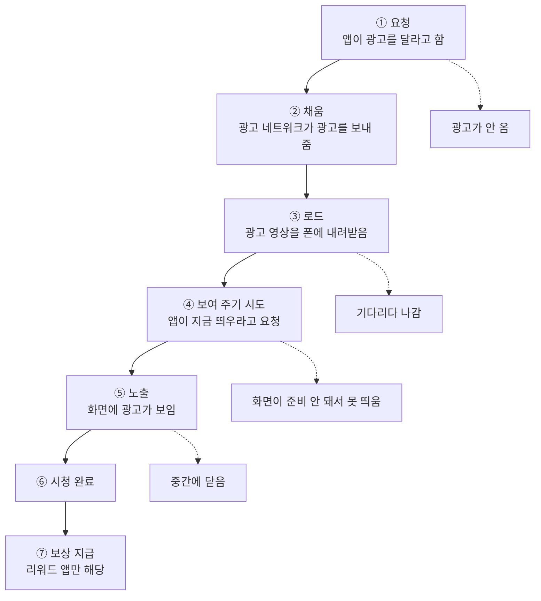
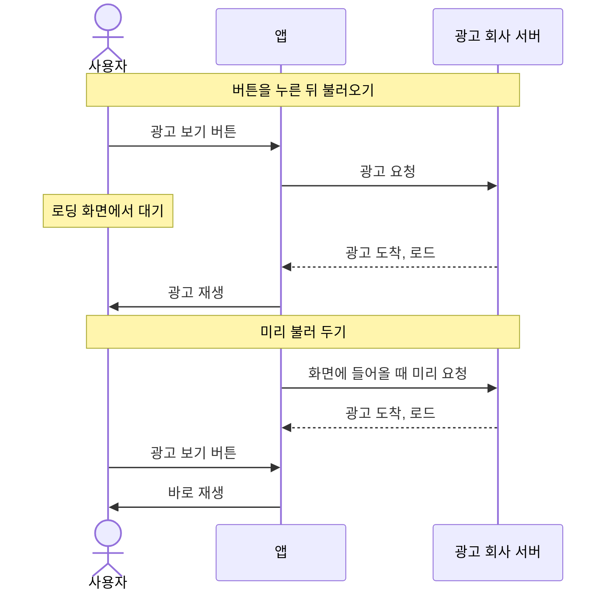
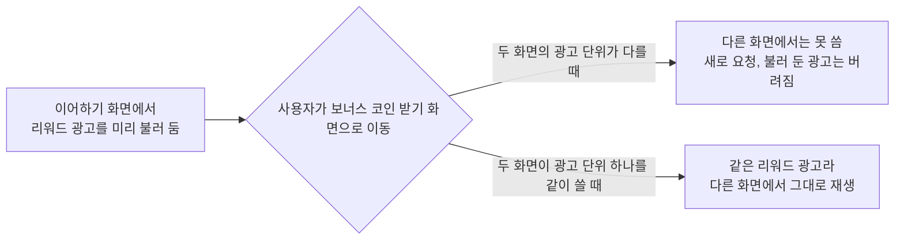
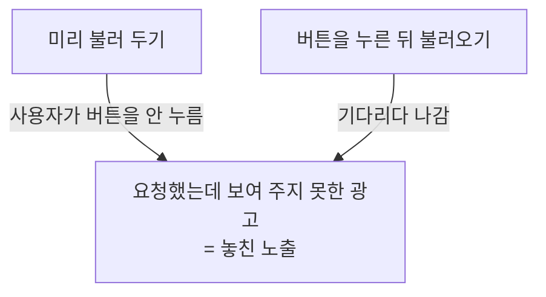
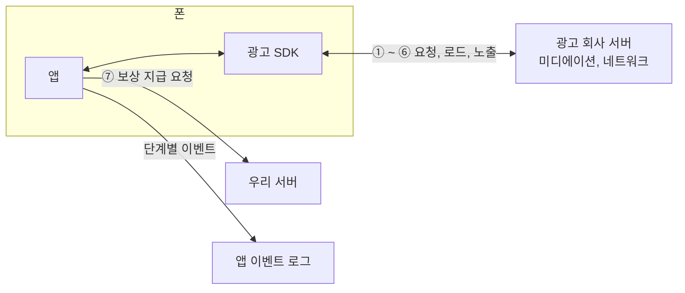

## 개요
지난 글에서는 광고 매출을 `광고가 보인 횟수 × 한 번당 단가`로 나눠 보고, 미디에이션이 빈자리를 채워서 광고가 보인 횟수를 늘린다는 데까지 정리했다.

이번 글에서는 그 앞쪽 숫자인 **광고가 보인 횟수**를 다룬다. 앱이 광고를 달라고 요청한 횟수와 실제로 화면에 광고가 보인 횟수는 같지 않은데, 그 사이에서 광고가 어디서, 왜 빠지는지를 광고 한 건이 화면에 뜨기까지의 단계를 따라가며 정리해 보려 한다.

## 퍼널이란
퍼널(funnel)은 깔때기라는 뜻으로, 단계를 거칠수록 숫자가 줄어드는 모양을 그리면 깔때기처럼 생겨서 붙은 이름이다.

빵집으로 예를 들어 보자.

```
가게 앞을 지나간 사람   100명
가게에 들어온 사람       30명
빵을 집은 사람           10명
계산한 사람               5명
```

"손님이 적다"는 사실만으로는 무엇을 고쳐야 할지 알 수 없지만, 단계별로 나눠 보면 보인다. 지나가는 사람은 많은데 들어오는 사람이 적다면 간판을 바꿔야 하고, 들어오는 사람은 많은데 계산하는 사람이 적다면 가격이나 맛을 봐야 한다.

광고도 마찬가지로, 빵집 손님 대신 광고 한 건을 따라가 보면 된다.

## 광고 한 건이 화면에 뜨기까지
사용자 입장에서는 버튼을 누르면 광고가 나오는 게 전부지만, 그 사이에는 여러 단계가 있다.



이 중 돈이 생기는 곳은 ⑤ **노출**이다. 리워드 광고는 대부분 광고가 보인 횟수를 기준으로 정산되기 때문에, 앞 단계를 아무리 많이 거쳐도 화면에 뜨지 않으면 매출은 0이다.

### 단계마다 빠지는 이유
| 구간 | 빠지는 이유 | 어느 쪽 문제인가 |
|---|---|---|
| 요청 → 채움 | 이 자리를 사겠다는 광고주가 없음, 광고주가 부른 값이 최저 가격보다 낮음 | 광고주, 광고 네트워크 |
| 채움 → 로드 | 네트워크가 느림, 정해진 시간 안에 못 받음 | 광고 네트워크, 기기 |
| 로드 → 보여 주기 시도 | 사용자가 기다리다 나감, 다른 화면으로 이동함 | 우리 앱 |
| 보여 주기 시도 → 노출 | 화면이 아직 준비되지 않은 상태라 띄우지 못함 | 우리 앱 |
| 노출 → 시청 완료 | 사용자가 중간에 닫음 | 사용자 |

이렇게 퍼널로 나눠 보면 광고 회사 쪽 문제인지 우리 앱 쪽 문제인지가 갈리고, 우리가 직접 고칠 수 있는 곳이 어디인지도 보인다.

## 지표로 보면
단계와 단계 사이의 비율에는 각각 이름이 붙어 있다.

| 지표 | 계산 | 뜻 |
|---|---|---|
| 일치율 (Match rate) | 받은 광고 ÷ 요청 | 달라고 한 광고 중 실제로 받은 비율 |
| 노출률 (Show rate) | 노출 ÷ 받은 광고 | 받은 광고 중 실제로 보여 준 비율 |
| 완료율 | 시청 완료 ÷ 노출 | 보인 광고 중 끝까지 본 비율 |

이 지표들을 지난 글의 매출 공식에 붙이면 다음과 같다.

```
광고 매출 = 광고가 보인 횟수 × 한 번당 단가
              ↓
           요청 × 일치율 × 노출률
```

예를 들어 광고를 100번 요청해서 80번 받았고 그중 70번을 보여 줬다면(가상의 숫자다), 일치율은 80%이고 노출률은 70 ÷ 80 = 87.5%가 된다.

처음에는 노출률을 70 ÷ 100 = 70%로 계산했는데, 노출률의 분모는 요청이 아니라 **바로 앞 단계인 받은 광고**다. 70%는 일치율과 노출률을 곱한 값이어서, 지표를 볼 때는 분모가 무엇인지부터 확인하는 습관이 필요하다.

## 미리 불러 두면 손해가 없을까
광고를 띄우는 방식은 크게 두 가지다. 사용자가 버튼을 누른 뒤에 광고를 불러오는 방식과, 버튼을 누르기 전에 미리 불러 두는 방식이다. 후자를 **프리로드**(preload)라고 한다.



광고 SDK 공식 가이드를 찾아보면 대부분 리워드 광고는 미리 불러 두고, 준비됐는지 확인한 뒤 보여 주는 방식을 기본으로 안내한다([AdMob](https://developers.google.com/admob/android/next-gen/rewarded), [AppLovin MAX](https://developers.applovin.com/en/android/ad-formats/rewarded-ads)). 사용자가 기다리지 않아도 되니 기다리다 나가는 사람도 줄어든다.

그래서 처음에는 버튼을 누른 뒤에 불러오는 방식이 그냥 비효율적이라고 생각했다. 돈은 노출 시점에 생기니까, 미리 받아 둔 광고를 보여 주지 않더라도 광고주는 돈을 내지 않고 앱도 잃을 게 없다고 봤다.

|        | 사용자가 봄 | 미리 받았지만 안 봄 |
| ------ | ------ | ----------- |
| 앱 수익   | 생김     | 없음          |
| 광고주 비용 | 냄      | 없음          |

표만 보면 손해가 없어 보이지만, 받아 놓고 보여 주지 않은 광고가 많아지면 **노출률이 떨어진다**. 미리 불러 두는 앱은 받은 광고 수가 실제 노출 수보다 훨씬 많아지기 쉽다는 설명도 있다([TradPlus 문서](https://docs.tradplusad.com/en/docs/operation/optimization_qa/qitashujuwentipaicha)). 그래서 프리로드를 쓰더라도 사용자가 확실히 광고를 볼 화면에만 적용하는 식으로 범위를 좁히기도 한다.

### 불러 둔 광고를 어디까지 다시 쓸 수 있나
미리 불러 둔 광고가 얼마나 버려지는지는 광고 단위를 어떻게 나누느냐에 따라서도 달라진다.

예를 들어 게임 앱의 '이어하기' 화면에서 리워드 광고를 미리 불러 뒀는데, 사용자가 이어하기를 하지 않고 '보너스 코인 받기' 화면으로 넘어갔다고 해 보자. 두 화면 모두 광고를 보면 보상을 주는 리워드 광고 자리다.



광고는 광고 단위(ad unit)라는 설정 단위로 불러온다. AdMob은 보통 광고 자리마다 광고 단위를 따로 만들기 때문에, 불러 둔 광고는 그 자리에서만 쓰게 된다. 반면 LevelPlay나 MAX는 [광고 단위 하나에 여러 자리를 붙일 수 있어서](https://docs.unity.com/en-us/grow/levelplay/sdk/android/rewarded-ads-integration), 같은 형식의 광고를 여러 자리에서 나눠 쓸 수 있다.

## 버튼을 누른 뒤 불러오면
그렇다면 버튼을 누른 뒤에 불러오는 방식에는 손실이 없을까?

미디에이션이 광고 네트워크 후보들에게 차례로 광고를 묻는 방식(워터폴)이라면, 버튼을 누르는 순간 첫 번째 후보에게 요청하고, 광고가 없거나 정해진 시간 안에 응답이 오지 않으면 다음 후보로 넘어간다. 후보마다 몇 초씩 기다리다 보니 실패가 겹치면 사용자가 기다리는 시간도 그만큼 길어진다.

```mermaid
gantt
    title 후보를 차례로 시도할 때 사용자가 기다리는 시간
    dateFormat ss
    axisFormat %S초
    section 광고 요청
    후보 1 응답 없음, 시간 초과   :a1, 00, 5s
    후보 2 광고 없음               :a2, after a1, 2s
    후보 3 광고 받음, 로드         :a3, after a2, 3s
    section 사용자
    로딩 화면에서 대기             :b1, 00, 10s
```



이렇게 기다리는 동안 사용자가 나가 버리면, 그 광고 역시 **요청은 했는데 보여 주지 못한 광고**가 된다. 프리로드를 조심하는 이유와 같은 손실이 이쪽에서도 생기는 것이다.

게다가 이 사용자는 직접 광고 보기 버튼까지 누른 사람이다. 광고를 볼 생각이 분명히 있었는데 놓친 것이라서, 미리 불러 둔 광고가 버려지는 경우보다 오히려 더 아까운 손실이다.

## 결국 같은 숫자로 비교해야 한다
정리하면 두 방식 모두 손실이 있고, 손실이 생기는 지점만 다르다.



그래서 어느 방식이 맞는지를 정하기보다는, **미리 불러서 버려지는 광고와 기다리다 놓치는 광고 중 어느 쪽이 더 많은지**를 따져 봐야 한다. 답은 화면마다 다를 수 있다. 사용자가 광고를 볼 게 확실한 화면이라면 미리 불러 두는 편이 유리하지만, 홈 화면처럼 사용자가 무엇을 누를지 모르는 곳에서는 어떤 광고를 불러 둘지 정하는 것부터 쉽지 않다.

결국 이걸 판단하려면 퍼널 숫자를 직접 봐야 한다.

## 퍼널을 보려면 무엇이 필요한가
광고를 요청하고 받는 일은 우리 서버를 거치지 않는다. 앱에 들어 있는 광고 SDK가 미디에이션이나 광고 네트워크의 서버와 주고받기 때문에, 앱이 따로 이벤트를 보내지 않으면 서버에서는 보상 지급 요청 정도만 볼 수 있다.



그래서 퍼널을 보려면 앱이 요청, 로드 완료, 보여 주기 시도, 열림, 노출, 완료 같은 단계마다 이벤트를 남기고, 그 이벤트를 앱 분석 도구나 자체 로그 저장소에 모아서 봐야 한다.

숫자를 볼 때 전체 평균만 보면 원인이 묻히기 쉬우니, 다음과 같은 기준으로 나눠 보는 게 좋다.

- **광고 자리별**: 어느 화면에서 많이 빠지는지
- **OS별**: Android와 iOS는 광고 SDK 구성이 다를 수 있다
- **광고 형식별**: 리워드 광고와 전면 광고
- **로딩 시간 구간별 이탈률**: 몇 초부터 사람들이 나가기 시작하는지

로딩 시간은 평균보다 **중앙값과 p90**을 보는 게 낫다. 후보 실패가 겹친 일부 요청이 평균을 크게 끌어올리기 때문인데, API 응답 시간을 평균보다 백분위로 보는 것과 같은 이유다.

## 마치며
광고 매출이 줄었다는 말만으로는 무엇을 고쳐야 할지 알 수 없지만, 퍼널로 나눠 보면 광고 회사 쪽 문제인지 우리 앱 쪽 문제인지가 보인다.

이번에 가장 크게 바뀐 건 광고를 미리 불러 두면 손해 볼 게 없다는 생각이었다. 미리 불러 두는 방식은 버려지는 광고만큼 노출률을 깎고, 버튼을 누른 뒤에 불러오는 방식은 기다리다 나간 사용자만큼 노출을 놓친다. 어느 쪽이 정답이라기보다는 화면마다 어느 쪽 손실이 더 큰지를 숫자로 재 보는 수밖에 없다.
